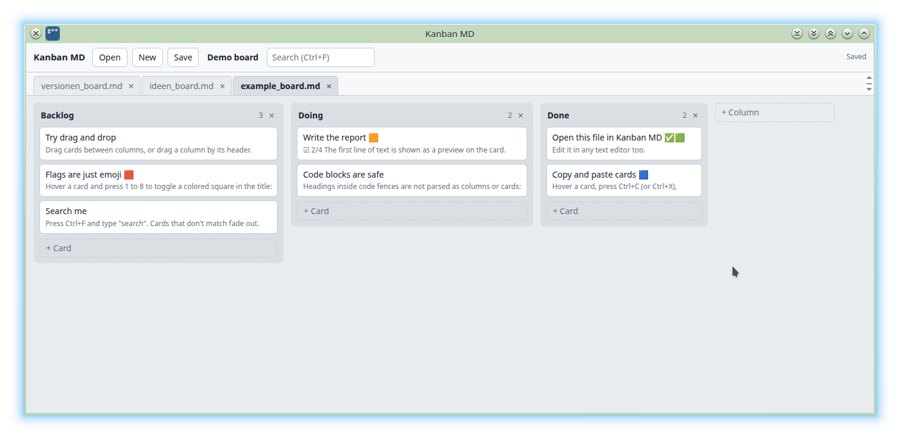

# Board MD

Use plain Markdown files as Kanban boards. One HTML file, no dependencies, no build step, no server. Your data stays on your machine.



## Quick start

1. Download `boardmd.html`.
2. Open it in Chrome, Edge, Brave or another Chromium browser.
3. Click **Open** and pick a `.md` file, or **New** to start a board.

Changes are saved to the file automatically. Because boards are plain `.md` files, you can edit them in any text editor, keep them in git, or sync them with tools like Syncthing. Changes made outside the app are picked up within a couple of seconds. If the file changed on disk, the version on disk wins and the app reloads it (unsaved edits in the app are replaced, with a notice in the status bar).

## Install on Linux

One-liner (asks for the install directory, defaults to the current one; uses `git` if available, otherwise downloads the zip, and adds a "Board MD" entry to your application menu):

```bash
curl -fsSL https://raw.githubusercontent.com/redPanther/board.md/main/install.sh | bash
```

Or from a checkout: `./install.sh`. It installs into `<directory>/board.md` and can be re-run to update. It needs a Chromium-based browser (Chromium, Chrome, Brave or Edge) for the launcher.

## File format

| Markdown | Meaning |
|---|---|
| `# Title` | Board title |
| `## Heading` | Column |
| `### Heading` | Card |
| Text below a heading | Description (shown as a one-line preview on cards) |
| `- [ ]` / `- [x]` | Checklist, shown as progress (e.g. ☑ 2/4) on the card |

Headings inside code fences are ignored, and headings with four or more `#` stay part of the card description. Text under the board title and column headings is preserved in the file. See [`examples/demo.board.md`](examples/demo.board.md) for an example.

## Colors

Colors are plain emoji characters in the card title, so they live in the `.md` file and show up everywhere.

| Key | Flag | Unicode |
|---|---|---|
| `1` | 🟥 | `U+1F7E5` |
| `2` | 🟧 | `U+1F7E7` |
| `3` | 🟨 | `U+1F7E8` |
| `4` | 🟩 | `U+1F7E9` |
| `5` | 🟦 | `U+1F7E6` |
| `6` | 🟪 | `U+1F7EA` |
| `7` | 🟫 | `U+1F7EB` |
| `8` | ⬜ | `U+2B1C` |

- **In the app:** hover a card and press `1`–`8` to toggle the flag in its title.
- **In a text editor, or for the legend line:** type or paste the character yourself:
  - Linux (GTK/GNOME): `Ctrl+Shift+U`, type the hex code (e.g. `1f7e5`), then `Space` or `Enter`. The emoji picker opens with `Ctrl+.` or `Ctrl+;`.
  - Windows: `Win+.`
  - macOS: `Ctrl+Cmd+Space`
  - or copy them from the table above.
- A legend line in the board description (`Legend: 🟥 Urgent · 🟩 Done`, see [Features](#features)) can use any emoji, not only these eight. The part before the first space of each entry is the tag a card must contain in its title.

## Features

- Drag and drop cards and columns
- Multiple boards in tabs
- Copy, cut and paste cards and columns between boards
- Drag a card or column onto another board's tab to move it there (a card goes into the column of the same name, else the first column; a column is appended at the end)
- Search that fades out non-matching cards
- Colored flags (emoji in the card title)
- Legend as filter: a line `Farben: 🟥 27.1 · 🟧 26.3 · 🟩 Hardware` in the board description (also `Legende:`, `Legend:`, `Flags:`) becomes a row of filter chips; click one to fade out all cards without that flag
- GitHub links: put a line `Repo: owner/name` (also `GitHub:`, a github.com URL works too) in the board description. Then `#123`, `owner/repo#123` and commit hashes (7–40 hex characters) in card titles and previews link to GitHub. `owner/repo#123` works without a `Repo:` line. The repo is shown at the right of the filter bar
- `[E]` / `[V]` badges: a `[E]`, `[V]` or `[V Coding]` tag in a card description is shown as a badge on the card and can be filtered ("decided" / "proposals")
- Archive a column (🗄 in the column header): it is appended to an `archiv.md` file (picked once, then remembered) and removed from the board. The archive is a normal board file; undo only restores the column in the board, not in the archive
- Cross-board links: a card whose title matches a card in another open board (flags and punctuation ignored) shows `↔ Board › Column`; click it to jump there
- Undo and redo per board
- Autosave to disk, no save dialog after the first permission prompt
- Remembers your open boards between visits
- Light and dark theme, follows the system setting

## Shortcuts

Card shortcuts apply to the card under the mouse pointer.

| Key | Action |
|---|---|
| `Enter` / click | Open card |
| `Esc` / `Ctrl+Enter` | Close card, clear search |
| `1`–`8` | Toggle colored flag |
| `Ctrl+C` / `Ctrl+X` / `Ctrl+V` | Copy / cut / paste card (paste goes into the hovered column) |
| `Ctrl+D` | Duplicate card |
| `Ctrl+C` / `Ctrl+X` / `Ctrl+D` over a column header | Copy / cut / duplicate the column (`Ctrl+V` pastes it after the hovered column) |
| `Del` / `Backspace` | Delete card |
| `Ctrl+Z` / `Ctrl+Shift+Z` | Undo / redo |
| `Ctrl+F` | Search |
| `Ctrl+S` | Save now |
| `?` | Show the built-in help (also the **?** button in the header and the **Help** link in the footer) |
| Double-click background | New column |
| Double-click a title | Rename column or board |

On macOS use `Cmd` instead of `Ctrl`.

## Browser support

Writing back to the original file uses the [File System Access API](https://developer.mozilla.org/docs/Web/API/File_System_API), which works in Chrome, Edge, Opera and Brave.

- **Brave:** enable `brave://flags/#file-system-access-api` and restart.
- **Firefox / Safari:** boards can be opened and edited, and open boards are remembered, but **Save** downloads a new `.md` instead of overwriting the file.

When you reopen the page, Chromium may ask again for file access. Click **Restore boards from last session** in the header to grant it.

## Run it like an app

Chromium browsers can open the page in its own window without tabs or address bar

### Windows
```
chrome app=file:///C:\Users\<your place\boardmd.html
```

### Linux

```
chromium --app=file:///path/to/boardmd.html
```

To add it to your application menu, create `~/.local/share/applications/boardmd.desktop`:

```
[Desktop Entry]
Type=Application
Name=Kanban MD
Exec=chromium --app=file:///path/to/board.html
Icon=/path/to/assets/boardmd.svg
Terminal=false
Categories=Office;ProjectManagement;
```

Replace `chromium` with `google-chrome-stable`, `chromium-browser` as needed. Add `--user-data-dir=$HOME/.config/boardmd` to give the app its own browser profile.


## License

GPL-3.0, see `LICENSE`.
